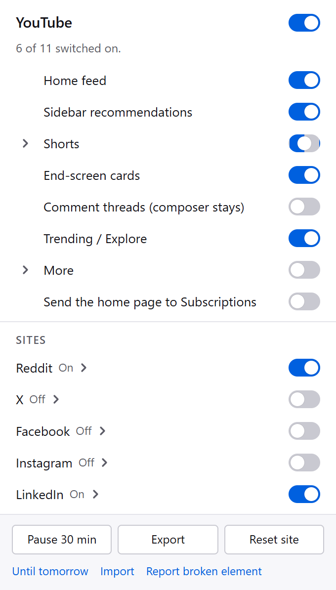
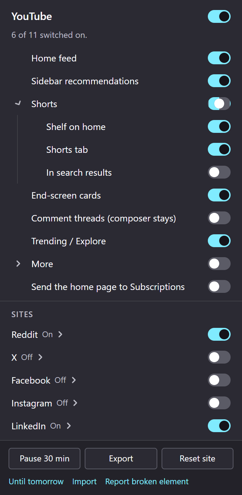

# FeedBlocker

Hide feeds, recommendations, Shorts and Reels in Firefox. Choose what to hide on each site, with separate controls for individual elements.

**YouTube · Reddit · X · Facebook · Instagram · LinkedIn**

[Install](#install) · [Development](#development) · [Report a problem](https://github.com/youssof20/feedblocker/issues) · [Privacy](marketing/privacy-policy.txt)

## Screenshots

<table>
  <tr>
    <th>YouTube · light mode</th>
    <th>Shorts options · dark mode</th>
  </tr>
  <tr>
    <td valign="top"></td>
    <td valign="top"></td>
  </tr>
</table>

The actual popup rendered with sample settings. These previews show the full panel, including content that scrolls in Firefox. [More screenshots](marketing/screenshots/).

## Features

- **Per-site controls.** Enable only the sites you want, then choose which elements to hide.
- **Immediate changes.** Switch a setting and the page updates without a Save button.
- **Show once.** Reveal supported hidden feeds until the next navigation.
- **Pause.** Restore content everywhere for 30 minutes or until tomorrow.
- **Portable settings.** Export and import JSON, with preferences stored in Firefox's sync storage.
- **Light and dark themes.** Keyboard controls, visible focus rings and high-contrast support.

CSS handles hiding. A small JavaScript runtime applies settings, manages temporary reveals and follows page navigation. There are no analytics, remote rules or automatic external network requests.

## Install

Requires **Firefox 140 or later** on desktop. This build is unsigned; Mozilla signing and live-site verification are still pending.

1. [Download the source ZIP](https://github.com/youssof20/feedblocker/archive/refs/heads/main.zip) and extract it, or clone this repository.
2. Open `about:debugging#/runtime/this-firefox` in Firefox.
3. Select **Load Temporary Add-on…** and choose `manifest.json` from the extracted folder.
4. Open a supported website, open FeedBlocker from the extensions menu, and enable the site.
5. Allow access when Firefox asks, then choose what to hide.

Temporary add-ons are removed when Firefox closes. No dependencies or build step are needed to load the checked-in extension.

## Site support

| Site | Available controls include |
| --- | --- |
| YouTube | Home feed, sidebar recommendations, Shorts, end-screen cards, comment threads |
| Reddit | Home / Popular / All feeds, sidebar communities, promoted posts, comment threads |
| X · Beta | For You timeline, trends, follow suggestions, Explore tab |
| Facebook · Beta | Home feed, Reels, Stories, right column |
| Instagram · Beta | Home feed, Reels, Explore, Stories tray |
| LinkedIn · Beta | Home feed, news panel, promoted posts |

Rules have not yet been audited against live logged-in pages. Site changes can break individual controls; use **Report broken element** in the popup to open an issue.

A few limits to know:

- X has no **Show once** placeholder.
- Firefox for Android is untested.
- On a cold page load, default hiding can briefly apply before saved preferences or pause settings are read.
- Import replaces your current settings. Pause applies to all enabled sites.
- FeedBlocker does not block entire websites or change autoplay settings.

## Privacy and permissions

Website access is optional and requested when you first enable a site. FeedBlocker uses `activeTab` to identify the current site, `scripting` to apply its rules, `storage` for preferences and `alarms` for pause expiry.

Preferences may sync through your Mozilla account when Firefox Sync is enabled. The developer does not receive them.

The report button opens a GitHub issue draft containing the current page URL, browser user agent and extension version. You can review it before submitting. See the [privacy policy](marketing/privacy-policy.txt) for details.

## Development

With Node.js installed:

```sh
node tools/build.js
node tools/test.js
node tools/check.js
```

Edit rules in `rules/<site>.json`, then rebuild and commit the generated CSS and `content/site-data.js` alongside your changes. See [development notes](docs/development.md) for the architecture, rule format and contribution guidelines.

To create the extension ZIP with PowerShell 7:

```powershell
pwsh -NoProfile -File tools/package.ps1
```

The script runs the build and checks, then writes `dist/feedblocker-1.0.0.zip`. Marketing assets and development tools are excluded. [Publishing assets and instructions](marketing/README.md) include icons, screenshots and store copy.

## Licence

[MIT](LICENSE).
